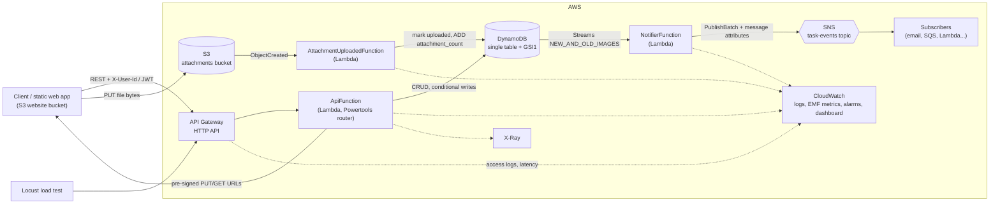

# ListLambda

A serverless task-management REST backend on AWS. Tasks live in DynamoDB, file
attachments go straight to S3 via pre-signed URLs, task changes fan out to SNS as domain
events, and everything is observable in CloudWatch. The whole stack is one AWS SAM
template, and a Locust suite load-tests it against a p99 latency target (100 ms by default).

## Features

- CRUD for tasks: title, description, status (`todo` / `in_progress` / `done`), priority,
  due date and tags. Each user only sees their own tasks.
- Listing by status, sorted by due date, served from a GSI (no scans), with cursor pagination.
- Optimistic concurrency: every task has a `version`, returned as an `ETag`. Send
  `If-Match` or `expected_version` on `PATCH` to get a `409` instead of a lost update.
- Attachments: the API hands out a pre-signed `PUT` URL, the client uploads to S3 directly,
  and an S3 event marks the attachment as uploaded and bumps the task's `attachment_count`.
- Events: a DynamoDB Streams consumer publishes `task.created`, `task.updated`,
  `task.completed`, `task.reopened`, `task.deleted` and `attachment.uploaded` to SNS, with
  `event_type` / `owner_id` message attributes you can filter on. You can optionally subscribe
  an email address to `task.completed`.
- Observability: structured JSON logs with correlation IDs, X-Ray traces, EMF business
  metrics, API access logs, a CloudWatch dashboard, and alarms for p99 latency, 5xx rate,
  Lambda errors and throttles, stream lag and DynamoDB throttles.
- A small static web client (`static/index.html`) served from an S3 website bucket.

## Architecture



### Data model (single table)

| Item        | PK            | SK                         | GSI1PK                          | GSI1SK                     |
|-------------|---------------|----------------------------|---------------------------------|----------------------------|
| Task        | `USER#<uid>`  | `TASK#<task_id>`           | `USER#<uid>#STATUS#<status>`    | `<due_date>#<task_id>`     |
| Attachment  | `USER#<uid>`  | `ATT#<task_id>#<att_id>`   | -                               | -                          |

Tasks with no due date use `9999-12-31` in `GSI1SK`, so they sort last.

### Why one API function?

All routes run in a single Lambda with an in-process router. That way one warm container
serves every route, so cold starts are rarer than they would be with a function per route,
and cold starts drive the p99. The function runs on arm64 with 512 MB, and boto3 clients
are created at module scope so warm invocations reuse their connections.

## API

Base URL: the `ApiUrl` stack output (it ends with the stage, e.g. `/dev`).

| Method | Path                                            | Description                                   |
|--------|-------------------------------------------------|-----------------------------------------------|
| GET    | `/health`                                       | Liveness check                                |
| POST   | `/tasks`                                        | Create a task                                 |
| GET    | `/tasks?status=&limit=&cursor=`                 | List tasks (optionally by status), paginated  |
| GET    | `/tasks/{id}`                                   | Get a task (returns `ETag`)                   |
| PATCH  | `/tasks/{id}`                                   | Partial update (`If-Match` supported)         |
| POST   | `/tasks/{id}/complete`                          | Mark done (idempotent)                        |
| DELETE | `/tasks/{id}`                                   | Delete the task and its attachments           |
| POST   | `/tasks/{id}/attachments`                       | Request a pre-signed upload URL               |
| GET    | `/tasks/{id}/attachments`                       | List attachments                              |
| GET    | `/tasks/{id}/attachments/{attachment_id}`       | Get a pre-signed download URL                 |
| DELETE | `/tasks/{id}/attachments/{attachment_id}`       | Delete an attachment                          |

Errors always have the form `{"error": {"code", "message", "details?", "request_id"}}`.

**Identity.** If you attach a JWT authorizer (for example Cognito) to the HTTP API, the
`sub` claim is the owner. When the stack parameter `AllowHeaderIdentity=true` (the dev
default), the `X-User-Id` header is accepted instead. That is meant for development and
load testing only, and the prod config sets it to `false`.

```bash
API=https://xxxx.execute-api.us-east-1.amazonaws.com/dev
curl -s -X POST "$API/tasks" -H 'X-User-Id: alice' -H 'Content-Type: application/json' \
  -d '{"title":"Ship v1","priority":"high","due_date":"2026-10-31","tags":["work"]}'
curl -s "$API/tasks?status=todo" -H 'X-User-Id: alice'
```

## Project layout

```
template.yaml            SAM template: DynamoDB, S3, SNS, HTTP API, Lambdas, CloudWatch
samconfig.toml           dev / prod deploy configs
src/listlambda/
  api.py                 HTTP API handler and routes
  models.py              Task model + request validation
  repository.py          DynamoDB access, pagination, optimistic locking
  attachments.py         S3 pre-signed URLs + S3 ObjectCreated handler
  events.py              Stream record -> domain event diffing
  notifier.py            DynamoDB Streams -> SNS publisher
  identity.py            JWT claim / X-User-Id resolution
  observability.py       Powertools logger, tracer, metrics
static/index.html        Minimal web client
tests/                   pytest suite (moto-mocked AWS)
loadtest/                Locust load test + headless runner
```

## How to run

Prerequisites: Python 3.12, the AWS CLI, AWS SAM CLI, and an AWS account with credentials
configured (`aws configure` or `AWS_PROFILE`). No secrets are stored in the repo.

```bash
make install            # dev dependencies (pytest, moto, locust, powertools)
make deploy             # sam build && sam deploy (dev stage, guided changeset confirm)
make outputs            # prints ApiUrl, StaticSiteUrl, DashboardUrl, ...
make publish-web        # uploads static/index.html to the website bucket
```

Optional deploy parameters (pass with `--parameter-overrides` or edit `samconfig.toml`):
`NotificationEmail` (subscribe an address to `task.completed`), `AlarmEmail`,
`LatencyP99ThresholdMs`, `LogRetentionDays`, `AllowedUploadOrigin`.

Open `StaticSiteUrl`, paste the `ApiUrl`, enter any user id, and you can manage tasks
from the browser.

Teardown: empty the attachments and web buckets first, then run `make destroy`.

## How to test

Unit and integration tests run fully offline. moto mocks DynamoDB, S3 and SNS, so you
don't need AWS credentials.

```bash
make test               # python -m pytest
make coverage           # with line coverage for src/listlambda
```

The suite covers validation, repository behaviour (GSI ordering, pagination, cursor
scoping, version conflicts), every API route including auth and error mapping, the full
attachment upload, confirm, download and purge flow, and stream-to-SNS event diffing with
partial batch failure reporting.

### Load testing

Run this against a deployed stack:

```bash
make loadtest                                   # 500 users, 5 minutes, headless
# or
API_URL=https://.../dev USERS=500 SPAWN_RATE=50 DURATION=5m ./loadtest/run.sh
```

Each simulated user gets its own identity, seeds a few tasks, and then runs a read-heavy
mix (list, get, create, update, complete, delete). The run writes a CSV and an HTML report
to `loadtest/results/`. It exits non-zero if the overall p99 goes over `P99_TARGET_MS`
(default 100) or the failure ratio goes over `MAX_FAILURE_RATIO` (default 1%), so you can
use it as a CI gate. Watch the CloudWatch dashboard during the run to see latency
percentiles, cold starts, DynamoDB capacity and event-pipeline lag.

Load tests against real AWS cost money (Lambda, API Gateway, DynamoDB on-demand). If you
need more than 500 concurrent users, raise the account's Lambda concurrency limit first.
